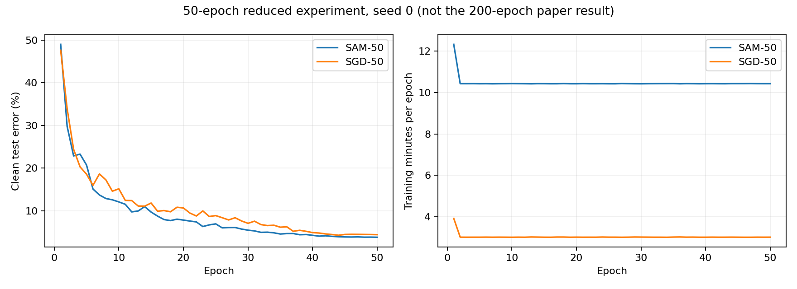

# Original JAX SAM versus SGD: completed 50-epoch experiment

Report date: November 19, 2026. Session: `20261118_231039_f309d8`. One seed (0), one sequential SAM/SGD pair. Final-epoch results are the primary endpoint.

## Outcome

Both runs completed successfully. SAM achieved **96.24% test accuracy (3.76% error)** and SGD achieved **95.63% accuracy (4.37% error)**. SAM improved final accuracy by **0.61 percentage points**, equivalent to 61 fewer errors on the 10,000-image test set (376 versus 437). The relative error reduction is **13.96%**. SAM used **3.45 times** the measured training time.

This supports the direction of SAM's generalization benefit in this reduced setup. It does not establish statistical significance, reproduce the full paper setting, or prove that flatter minima caused the improvement. This report concerns the original JAX run, not the independent PyTorch pilot.

| Final epoch 50 | SAM | SGD |
|---|---:|---:|
| Test accuracy | 96.24% | 95.63% |
| Test error | 3.76% | 4.37% |
| Test cross-entropy | 0.113833 | 0.175841 |
| Training time, summed epochs | 8.7224 h | 2.5297 h |
| Training-worker wall time | 8.7921 h | 2.5993 h |
| Median training epoch, epochs 2–50 | 10.4288 min | 3.0164 min |
| Epochs completed | 50 | 50 |
| Resumed | No | No |

[Final result CSV](../../results/js2_50epoch_summary/final_results.csv)

## Configuration and execution checks

The saved configuration uses CIFAR-10, WideResNet-28-10, seed 0, batch 256 split into eight logical sub-batches of 32, learning rate 0.1, weight decay 0.0005 and global gradient clipping at 5. SAM rho is 0.05; the saved SGD settings explicitly set rho to 0.0. The original worker uses Nesterov momentum, basic image augmentation, and original authors' training functions. Both methods use a 50-epoch cosine learning-rate horizon. They ran sequentially on the same JS2 A100 instance, `csci567-sam`.

Source revision: `f7b9ff46ee0deab8004d5508baf68b7e7c3dad1a`. Both manifests record identical worker SHA-256 `dddc3bf1ab21bd8671172e83fbbb534cd2cde354dc64c8a010dc1ac114ea1919`. Recorded runtime: Python 3.8.20, JAX 0.2.6, jaxlib 0.1.57, Flax 0.2.2, TensorFlow 2.3.1 and NumPy 1.18.5. Deterministic XLA reductions and cuDNN controls were enabled.

Inspection of the downloaded evidence confirmed:

- Exactly 50 ordered epoch records per method, each evaluating all 10,000 test examples; recorded numeric metrics are finite.
- Both strict preflights report `passed`, including numerical comparison, reference repeatability, finite eight-replica computation, shared optimizer step, parameter changes and eight BatchNorm states. These are the implemented checks, not a proof of every possible implementation property.
- Both preflight checkpoint roundtrips passed. The four retained training checkpoints (epochs 49 and 50 for each method) match their metadata SHA-256 hashes. No model/checkpoint deserialization or new training was performed during this analysis.
- Both training statuses report `complete`, 50 epochs, `resumed: false`. All four session budget attempts (two preflights and two training workers) exited with code 0.
- The final learning rate is approximately 2.98e-9 for both methods. Near-zero LR is expected at the end of this deliberately completed 50-epoch cosine schedule; it is not the earlier problem of accidentally compressing a longer pilot schedule.

## How training progressed

| Epoch | SAM test accuracy | SGD test accuracy |
|---|---:|---:|
| 1 | 50.96% | 52.36% |
| 2 | 70.22% | 66.08% |
| 5 | 79.28% | 81.44% |
| 10 | 87.95% | 84.87% |
| 20 | 92.21% | 89.37% |
| 30 | 94.58% | 92.97% |
| 40 | 95.79% | 95.15% |
| 45 | 96.17% | 95.58% |
| 50 | 96.24% | 95.63% |

Both methods learned rapidly early on and continued improving as the learning rate decreased. SGD was ahead at epochs 1 and 5; SAM was ahead at epochs 10, 20, 30, 40 and 50. Thus the first few epochs alone would not have predicted the final comparison reliably.

SAM improved from 50.96% at epoch 1 to 87.95% at epoch 10 and 96.24% at epoch 50. Its final test cross-entropy is lower as well as its final classification error. Over epochs 41–50, SAM's error moved from 4.02% to 3.76%, with small fluctuations. Its final epoch also happened to be its best observed accuracy.

SGD improved from 52.36% to 84.87% to 95.63% at the same epochs. Its lowest observed error was 4.23% at epoch 44; the final 4.37% is 0.14 points higher. This small late fluctuation is not evidence of catastrophic instability. We report epoch 50, not a retrospectively selected best epoch.

The saved histories contain test metrics and timing, not an epoch-level training loss/accuracy series. Therefore we cannot quantify the train–test generalization gap or conclude that either model overfit based on these records alone. No sustained divergence or non-finite metric is evident in the saved epoch histories.

## Compute cost and timing

SAM's first training epoch took 739.78 seconds; subsequent epochs ranged from **625.39 to 626.16 seconds**. SGD's first took 235.43 seconds; subsequent epochs ranged from **180.79 to 181.56 seconds**. This is very stable throughput after startup. The first-epoch overhead is consistent with initialization/compilation effects, but its exact causes were not separately profiled.

Evaluation took 169.89 seconds total for SAM and 167.58 seconds for SGD. Training alone totaled **11.2521 hours**; training-worker wall time totaled **11.3914 hours**, including evaluation and other worker overhead. The budget supervisor's two training attempts charged **11.3926 hours**. The two preflights charged **0.3250 hours**. This session therefore charged **11.7176 hours** including preflight and supervisor overhead.

The saved cumulative ledger reports **13.9188 hours used / 26.0812 hours remaining** from its 40-hour limit. About **2.2012 hours** preceded this session. These earlier charges are not part of the 50-epoch training cost. This ledger is not a complete cloud invoice: idle allocation, archive preparation and transfer are not included. Unimported external experiment time must be reconciled separately; do not interpret the ledger balance as independently verified total project allocation.

SAM's training-time overhead over SGD was **6.1926 hours**, or **3.45x** at equal epoch count. This is the observed cost of this implementation on this machine, not a universal SAM multiplier. The run is an equal-epoch comparison, not an equal-compute comparison. No continuous GPU-utilization or training peak-memory series was available in this archive, so those quantities are not inferred from elapsed time or spare VRAM.

The previous roughly 60-hour concern referred to a longer experiment and preflight extrapolations, not this completed 50-epoch pair. Actual measured costs above should be used for reporting this experiment.

## Interpretation and next steps

This is a successful reduced replication of the qualitative comparison: SAM gives lower final test error than momentum SGD using the original training implementation. It is **not a reproduction of the paper's full numerical result**: duration and seed coverage are reduced, and no sharpness/landscape measurement was made. We have one paired seed, so between-seed SD, a paired t-based confidence interval and significance cannot be estimated. Per-image predictions are also absent, so a paired per-example significance test cannot be reconstructed from aggregate accuracies.

Preserve this pair as the primary result. A useful next experiment, subject to budget approval, is additional paired seeds with the same frozen configuration to assess repeatability. A compute-matched comparison is a separate question and must be labeled separately. Do not start extra runs merely to improve the reported number. The independent two-epoch PyTorch pilot remains separate evidence and does not replace these original-code results.

## Preserved evidence

- [Extracted session](../../results/js2_50epoch/extracted/runs_50epoch/20261118_231039_f309d8): configuration, worker/supervisor snapshots, manifests, diagnostics, logs, histories and retained checkpoints.
- [Original archive](../../results/js2_50epoch/sam_50epoch_results.tar.gz), preserved unchanged. SHA-256: `5b4d87513f0ecd1539c3a264fac9d1ad898c96eed493c92cb79cd2faee6acfe0`; previously matched against the remote archive.
- [Budget snapshot](../../results/js2_50epoch/extracted/gpu_budget.json).
- [SAM history](../../results/js2_50epoch/extracted/runs_50epoch/20261118_231039_f309d8/train/SAM-50_seed_0/history.json) and [SGD history](../../results/js2_50epoch/extracted/runs_50epoch/20261118_231039_f309d8/train/SGD-50_seed_0/history.json).

Extraction rejected links and paths outside the destination. The instance was confirmed `SHELVED_OFFLOADED` after verified download. Raw archives/checkpoints remain local and are excluded from Git; only the small curated summary and this report are intended for sharing.
