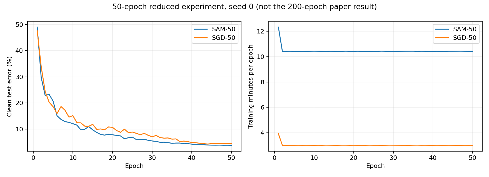

# Final 50-epoch SAM versus SGD results

Prepared for the November 20 report review. **This is the completed final result for our reduced 50-epoch experiment**, not the full-duration numerical replication from the paper. Run: `20261118_231039_f309d8`.

## Setup and measured outcome

CIFAR-10, WideResNet-28-10, one paired seed (0), 50 epochs per method, batch 256 implemented as eight logical sub-batches of 32. Original authors' JAX training functions, Nesterov momentum, initial learning rate 0.1, 50-epoch cosine schedule, weight decay 0.0005, clipping at 5, basic augmentation; SAM radius 0.05 versus SGD radius 0. Both ran sequentially on the same A100. This is separate from the later ResNet-18/CIFAR-100 hypothesis experiment and the discarded PyTorch pilot.

| Final epoch 50 | SGD | SAM |
|---|---:|---:|
| Test accuracy (%) | 95.63 | **96.24** |
| Test error (%) | 4.37 | **3.76** |
| Test cross-entropy | 0.175841 | 0.113833 |
| Summed training time (hours) | 2.5297 | 8.7224 |

SAM improved accuracy by **0.61 percentage points**: 61 fewer mistakes on 10,000 test images. Relative error reduction was 13.96%; training cost was 3.45 times SGD at equal epoch count. Both runs finished all 50 epochs without resume. The endpoint is the last epoch, not the best observed test result. Epoch-by-epoch test reporting is disclosed; it does not provide an independent validation selection procedure.

## What this supports

This is a successful reduced comparison showing the expected direction of SAM's generalization advantage. With only one seed, we cannot estimate between-seed uncertainty or claim a statistically established improvement. It is not the paper's full numerical reproduction and it does not identify the mechanism behind SAM. No input-sensitivity, PGD or sharpness measurements were collected in this experiment. Training accuracy was not logged, so a matched-training-accuracy argument cannot be made.

Suggested report wording:

> In a reduced CIFAR-10/WideResNet-28-10 experiment using the original JAX training implementation, SAM reached 96.24% final test accuracy versus 95.63% for SGD after 50 epochs. The 0.61 percentage-point gain supports the qualitative direction of the paper's comparison, but this single-seed, shortened run does not establish reproducibility of the paper's exact result or explain the gain causally.

## Files and compute accounting

- [final_results.csv](final_results.csv): original final-epoch summary.
- [epoch_metrics.csv](epoch_metrics.csv): both complete 50-epoch histories, exported as one table.
- [run_metadata.json](run_metadata.json): saved configuration and run identity.
- [learning_curves.png](learning_curves.png): original saved curves.
- [Detailed existing analysis](../../docs/results/js2_50epoch_results_analysis.md): configuration, checks, provenance and runtime breakdown.

Training alone took **11.2521 h**. The session, including preflight and supervisor overhead, charged **11.7176 h**. The older cumulative ledger was **13.9188 h**, which includes earlier work; these numbers must not be added together. Idle allocation and transfers are not included.

The full archive remains local at `results/js2_50epoch/sam_50epoch_results.tar.gz` (about 1.6 GB). SHA-256: `5b4d87513f0ecd1539c3a264fac9d1ad898c96eed493c92cb79cd2faee6acfe0`. It is intentionally excluded from Git. Share the archive separately if checkpoints are needed; the files here suffice for the report tables and figure. Original logs, checkpoints and executed notebooks remain preserved.
